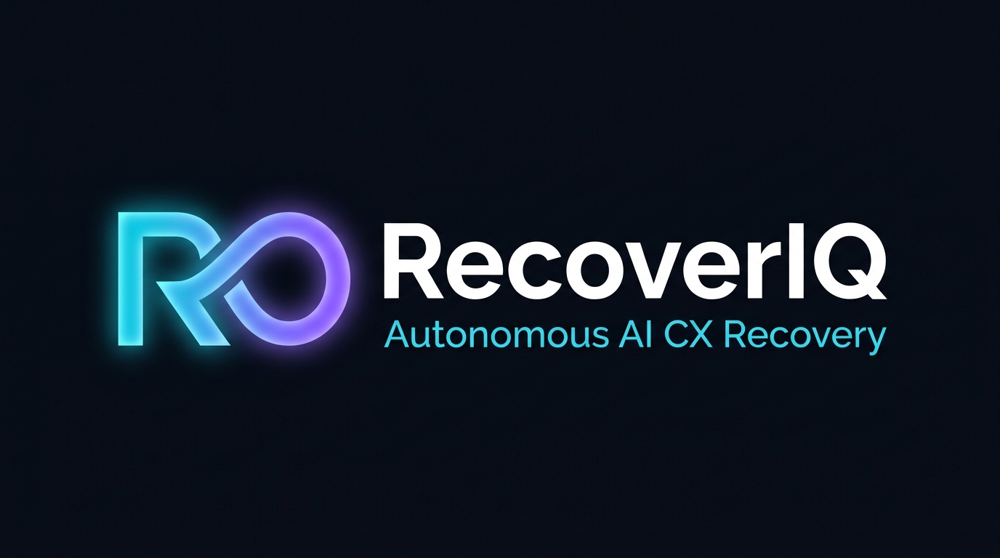

# RecoverIQ — Technical Architecture Specification

<p align="center">
  
</p>

**Project Name:** RecoverIQ  
**Challenge:** TCS Challenge 06 — Autonomous Customer Experience Recovery  
**Version:** 1.0 (Production & Demo Architecture)  
**Date:** October 2026  

---

## 1. Executive Summary & Core Philosophy

**RecoverIQ** is an autonomous, closed-loop customer experience recovery platform designed to detect, diagnose, quantify, and remediate customer-impacting operational failures in real time. 

Traditional application performance monitoring (APM) tools alert on low-level infrastructure failures, while customer support desks process complaints reactively in silos. RecoverIQ bridges this divide by connecting unstructured customer feedback directly to operational telemetry, code deployments, and customer cohorts.

### The Autonomous Recovery Pipeline

$$\text{Multichannel Signals} \longrightarrow \text{Semantic Issue Clusters} \longrightarrow \text{Cohort Lift Analysis} \longrightarrow \text{Root Cause Court} \longrightarrow \text{Financial Impact} \longrightarrow \text{Human-in-the-Loop Interventions} \longrightarrow \text{KPI Verification}$$

### Core Operating Principles & Guardrails
1. **Signal $\neq$ Proof:** A spike in customer complaints or negative sentiment is a symptom, not proof of a root cause.
2. **Correlation $\neq$ Causation:** Competing hypotheses and decoy explanations (e.g. weather delays, pricing sentiment) are systematically stress-tested and eliminated.
3. **No Unsubstantiated Blame:** Hypotheses lacking telemetry are explicitly marked **Untested**, never **Rejected**.
4. **Impact Segregation:** Direct measured losses (e.g. captured payments without orders) are strictly separated from estimated churn risks.
5. **Closed-Loop Verification:** Execution of a fix does not mark an incident resolved; resolution requires post-intervention telemetry verification against predefined KPI thresholds.

---

## 2. High-Level Architectural Topology

RecoverIQ is built as a modular 3-tier architecture with clear separation between user interaction, API orchestration, and agentic intelligence:

```
┌─────────────────────────────────────────────────────────────────────────────────────────┐
│                                FRONTEND CLIENT (React 19)                               │
│                                                                                         │
│   ┌──────────────────────────┐  ┌───────────────────────────┐  ┌─────────────────────┐ │
│   │ Executive Dashboard      │  │ Interactive Causal Graph  │  │ Root Cause Court    │ │
│   │ (Pipeline Stages & KPIs) │  │ (@xyflow/react DAG)       │  │ (5 Causal Tests)    │ │
│   └──────────────────────────┘  └───────────────────────────┘  └─────────────────────┘ │
│   ┌──────────────────────────┐  ┌───────────────────────────┐  ┌─────────────────────┐ │
│   │ Evidence Injection Modal │  │ Remediation & Approvals   │  │ Customer Recovery   │ │
│   │ (What-if Scenario Sim)   │  │ (Audit Trail & Execution) │  │ (Rehydration / SMS) │ │
│   └──────────────────────────┘  └───────────────────────────┘  └─────────────────────┘ │
└────────────────────────────────────────────┬────────────────────────────────────────────┘
                                             │ REST API (JSON / CORS)
                                             │ Base URL: /api/v1
                                             ▼
┌─────────────────────────────────────────────────────────────────────────────────────────┐
│                               BACKEND API (Python FastAPI)                              │
│                                                                                         │
│   ┌──────────────────────────┐  ┌───────────────────────────┐  ┌─────────────────────┐ │
│   │ API Routing (/api/v1)    │  │ Business Services Layer   │  │ Pydantic Validation │ │
│   │ Versioned Controllers    │  │ Orchestration & Logic     │  │ Schemas (DTOs)      │ │
│   └──────────────────────────┘  └───────────────────────────┘  └─────────────────────┘ │
│   ┌──────────────────────────┐  ┌───────────────────────────┐  ┌─────────────────────┐ │
│   │ Database & State Storage │  │ Security & Config         │  │ CORS & Middleware   │ │
│   │ ORM / Session Management │  │ BaseSettings Management   │  │ Error Interception  │ │
│   └──────────────────────────┘  └───────────────────────────┘  └─────────────────────┘ │
└────────────────────────────────────────────┬────────────────────────────────────────────┘
                                             │ Internal Python Integration / Async Calls
                                             ▼
┌─────────────────────────────────────────────────────────────────────────────────────────┐
│                             AI SERVICES & REASONING LAYER                               │
│                                                                                         │
│   ┌──────────────────────────┐  ┌───────────────────────────┐  ┌─────────────────────┐ │
│   │ LLM Provider Engine      │  │ RAG Pipeline              │  │ ChromaDB Vector DB  │ │
│   │ (Gemini 2.5 / OpenAI)    │  │ Context-Grounding Search  │  │ Semantic Embeddings │ │
│   └──────────────────────────┘  └───────────────────────────┘  └─────────────────────┘ │
│   ┌──────────────────────────┐  ┌───────────────────────────┐  ┌─────────────────────┐ │
│   │ Multi-Agent System       │  │ Custom Agent Tools        │  │ Guardrail Prompts   │ │
│   │ Causal Reasoner & Solver │  │ APM, Anomaly, Math Engine │  │ Zero-Hallucination  │ │
│   └──────────────────────────┘  └───────────────────────────┘  └─────────────────────┘ │
└─────────────────────────────────────────────────────────────────────────────────────────┘
```

---

## 3. Frontend Architecture (`client/`)

### 3.1 Technology Stack

| Technology | Version | Purpose |
| :--- | :--- | :--- |
| **React** | `^19.3.1` | Core UI library utilizing functional components and modern state primitives |
| **Vite** | `^8.3.5` | Next-generation frontend build tooling and HMR dev environment |
| **Tailwind CSS** | `^4.3.3` | Modern CSS engine with `@tailwindcss/vite` for custom glassmorphism and theme styles |
| **@xyflow/react** | `^12.12.0` | React Flow engine powering interactive causal DAG workflows and lineage graphs |
| **Recharts** | `^3.10.1` | Composable SVG charting for KPI tracking, trend lines, and recovery monitoring |
| **@tanstack/react-query**| `^5.105.0` | Server-state caching, background synchronization, and query invalidation |
| **Axios** | `^1.21.0` | Promise-based HTTP client configured with base URL and error interceptors |
| **React Router DOM** | `^7.18.5` | Client-side declarative routing and URL parameter synchronization |
| **Lucide React** | `^1.65.0` | Consistent vector iconography across all dashboard views |
| **clsx & tailwind-merge** | `^2.1.1` | Conflict-free conditional CSS utility concatenation |

### 3.2 Directory Structure & Key Modules

```
client/src/
├── api/
│   └── client.js                     # Axios HTTP client instance & interceptors
├── app/
│   ├── App.jsx                       # Application root with React Query provider
│   ├── providers.jsx                 # Global state and context wrappers
│   └── router.jsx                    # Route definitions (React Router v7)
├── components/
│   ├── agent-trace/
│   │   └── AgentTraceTimeline.jsx    # Displays agent reasoning steps, tools, and execution latency
│   ├── common/
│   │   ├── Badge.jsx                 # Status, severity, and lift indicator chips
│   │   ├── Button.jsx                # Themed action buttons with loading states
│   │   ├── Card.jsx                  # Glassmorphic container with glow borders
│   │   ├── Drawer.jsx                # Slide-over panels for node inspection
│   │   ├── Modal.jsx                 # Accessible dialog containers
│   │   └── LoadingSkeleton.jsx       # Smooth placeholder animations
│   ├── dashboard/
│   │   ├── ActiveIncidentsPanel.jsx  # Active incident summaries and severity cards
│   │   ├── ApprovalsTable.jsx        # Pending/approved recovery actions
│   │   ├── PipelineConnector.jsx     # Visual stage connectors for the golden path
│   │   ├── PipelineStageCard.jsx     # Cards representing the 7 pipeline phases
│   │   ├── RecommendationsPanel.jsx  # Top suggested recovery interventions
│   │   ├── StatCard.jsx              # High-level metrics (impact, active issues, recovery rate)
│   │   └── StatusChip.jsx            # State indicators (Supported, Disproven, Improving)
│   ├── evidence/
│   │   ├── EvidenceExplorer.jsx      # Telemetry logs, commits, webhooks, and tickets
│   │   └── EvidenceInjectionModal.jsx# Live simulation: inject new telemetry to trigger re-assessment
│   ├── incidents/
│   │   ├── BusinessImpactView.jsx    # Direct vs estimated loss breakdown
│   │   ├── CustomerRecoveryListView.jsx # Rehydration, refund, and voucher tracking per user
│   │   └── SelfEvaluationScorecard.jsx # Automated benchmark validation tests
│   ├── issue-graph/
│   │   ├── CustomNodes.jsx           # Specialized node components for React Flow DAG
│   │   └── IssueGraph.jsx            # Reactive DAG visualization from signal to intervention
│   ├── kpis/
│   │   └── KPIMonitoringView.jsx     # Recharts charts comparing pre/post-intervention metrics
│   ├── layout/
│   │   └── AppLayout.jsx             # Shell layout containing navigation header & sidebar
│   ├── navigation/
│   │   ├── Header.jsx                # Top app bar with system status & search
│   │   └── Sidebar.jsx               # Navigation bar for quick view switching
│   ├── recommendations/
│   │   └── RecommendationsList.jsx   # Intervention list with risk scores & action buttons
│   ├── root-cause/
│   │   └── RootCauseCourt.jsx        # 5-test hypothesis evaluation table & decoy verdicts
│   └── segments/
│       └── AffectedSegments.jsx      # Cohort analysis table with lift ratios and p-values
├── fixtures/
│   └── demoState.js                  # Initial demo state fixtures
├── mocks/
│   └── data.js                       # Comprehensive synthetic dataset (planted incident + 3 decoys)
├── pages/
│   ├── DashboardPage.jsx             # Executive overview of the entire recovery lifecycle
│   ├── IncidentDetailPage.jsx       # Deep-dive incident command center
│   ├── FeedbackPage.jsx              # Multichannel customer feedback stream
│   ├── SignalsPage.jsx               # Emerging anomalies and volume surges
│   ├── IncidentsPage.jsx             # Master incident registry
│   ├── ApprovalsPage.jsx             # Dedicated human-in-the-loop review board
│   ├── RecoveryPage.jsx              # Financial recovery & customer reconciliation
│   └── IngestionPage.jsx             # Synthetic ingestion injector
├── services/
│   ├── api.js                        # Environment configuration and mock switcher
│   ├── incidents.service.js          # Incidents, evidence, court, and impact APIs
│   ├── signals.service.js            # Anomaly signals APIs
│   ├── feedback.service.js           # Feedback search and ingestion APIs
│   ├── approvals.service.js          # Action approval & execution APIs
│   └── kpis.service.js               # Telemetry verification APIs
└── styles/
    └── globals.css                   # Global styles, scrollbars, and dark theme definitions
```

### 3.3 Dual-Mode Data Architecture

To ensure 100% demo reliability under volatile network conditions, the frontend features an enterprise-grade service adapter pattern (`client/src/services/api.js`):

```javascript
export const USE_MOCKS = import.meta.env.VITE_USE_MOCKS === 'true' || import.meta.env.VITE_USE_MOCKS === undefined;
```

* **Live Mode (`USE_MOCKS=false`):** Routes all requests through Axios to the FastAPI backend (`http://localhost:8000/api/v1`).
* **Mock Mode (`USE_MOCKS=true`):** Simulates realistic async network latency (100–150ms) and serves high-fidelity synthetic incident data from `mocks/data.js`, allowing full interactive execution, evidence injection, and state mutation even without a running backend.

---

## 4. Backend Architecture (`server/`)

### 4.1 Technology Stack

| Technology | Version | Purpose |
| :--- | :--- | :--- |
| **Python** | `3.13+` | Modern asynchronous programming runtime |
| **FastAPI** | `>=0.115.0` | High-performance asynchronous web framework |
| **Uvicorn** | `>=0.30.0` | Production-grade ASGI server with worker concurrency |
| **Pydantic** | `>=2.9.0` | High-speed data parsing, typing, and schema validation |
| **Pydantic Settings** | `>=2.5.0` | Environment variable parsing and configuration management |
| **Python Dotenv** | `>=1.0.1` | Local environment configuration file loader |

### 4.2 Directory Structure & Organization

```
server/
├── app/
│   ├── api/
│   │   └── v1/
│   │       ├── endpoints/
│   │       │   ├── health.py         # Health check and environment probe
│   │       │   └── (extensible)      # Incident, signal, feedback, and action endpoints
│   │       ├── api.py                 # Central APIRouter aggregation for version 1
│   │       └── __init__.py
│   ├── core/
│   │   ├── config.py                  # Pydantic BaseSettings (CORS, URLs, API Versioning)
│   │   ├── security.py                # Security & hashing utilities
│   │   └── __init__.py
│   ├── db/
│   │   ├── session.py                 # Database connection and session lifecycle
│   │   └── __init__.py
│   ├── models/
│   │   ├── base.py                    # Base ORM / data model definitions
│   │   └── __init__.py
│   ├── schemas/
│   │   ├── health.py                  # Typed request/response schemas (DTOs)
│   │   └── __init__.py
│   ├── services/
│   │   ├── base.py                    # Business logic and domain service abstraction
│   │   └── __init__.py
│   ├── utils/
│   │   └── __init__.py                # Cross-cutting utility functions
│   └── main.py                        # Application factory pattern (create_app())
├── requirements.txt                   # Backend dependencies
├── .env.example                       # Template for environment configuration
└── README.md
```

### 4.3 Backend Architectural Patterns

1. **Application Factory Pattern (`create_app`):** Encapsulates CORS configuration, middleware registration, and router inclusion in an explicit factory function for easy testing.
2. **Versioned API Structure (`/api/v1`):** Isolates API endpoints under versioned prefixes to ensure backward compatibility as endpoints evolve.
3. **Automated OpenAPI / Swagger Integration:** Exposes interactive Swagger UI at `/api/v1/docs` and ReDoc at `/api/v1/redoc` directly from Pydantic schemas.

---

## 5. AI Services Architecture (`ai_services/`)

### 5.1 Technology Stack

| Technology | Version | Purpose |
| :--- | :--- | :--- |
| **google-genai** | `>=0.1.1` | Official Google GenAI SDK for Gemini 2.5 Flash / Pro reasoning |
| **openai** | `>=1.50.0` | OpenAI API client for GPT-4o / GPT-4o-mini execution |
| **langchain** | `>=0.3.0` | Agent chain execution and memory orchestration |
| **chromadb** | `>=0.5.0` | Vector database for embedding storage and semantic similarity retrieval |
| **tiktoken** | `>=0.8.0` | Fast BPE tokenization and token budget management |

### 5.2 Directory Structure & Module Responsibilities

```
ai_services/
├── agents/
│   └── base_agent.py              # BaseAgent class for multi-turn reasoning and tool invocation
├── chains/
│   └── rag_pipeline.py            # Retrieval-Augmented Generation pipeline using ChromaDB
├── prompts/
│   └── templates.py               # Guardrailed system prompts enforcing factual adherence
├── providers/
│   └── llm_provider/
│       └── __init__.py            # Unified LLM provider factory (Gemini & OpenAI)
├── tools/
│   └── custom_tools.py            # Agent tool definitions (APM queries, anomaly math)
├── utils/
│   └── text_splitter.py           # Text chunking strategies for customer complaints
├── vector_store/
│   └── vector_db.py               # Vector database client managing collections and queries
├── config.py                      # AI settings & credentials management
└── requirements.txt               # AI service dependencies
```

### 5.3 Core AI Capabilities

1. **Provider-Agnostic LLM Client (`LLMProvider`):** An abstract adapter allows the entire agent system to switch between Google Gemini and OpenAI models dynamically using `DEFAULT_MODEL_PROVIDER` in `ai_services/config.py`.
2. **Deterministic Tool Invocation:** The reasoning agents do not guess operational states. They execute specialized tools:
   * `anomaly_detector.query_spikes()`: Identifies statistically significant volume changes against baselines.
   * `nlp_cluster.extract_entities()`: Performs semantic grouping without predefined labels.
   * `datadog_apm.get_latency_breakdown()`: Pulls backend trace durations and socket abort counts.
   * `causal_reasoner.evaluate_hypotheses()`: Executes the 5 causal court tests.

---

## 6. The 5-Test Causal Engine ("Root Cause Court")

A foundational innovation of RecoverIQ is the **Root Cause Court**, which prevents LLM hallucinations and correlation fallacies by subjecting every candidate hypothesis to five rigorous causal validation tests:

```
                                  Candidate Hypothesis
                                           │
          ┌────────────────────────────────┼────────────────────────────────┐
          ▼                                ▼                                ▼
    [Test 1]                         [Test 2]                         [Test 3]
Temporal Relationship           Segment Specificity              Operational Telemetry
Did symptom follow cause?       Is issue isolated to cohort?     Does system data prove it?
          │                                │                                │
          └────────────────────────────────┼────────────────────────────────┘
                                           │
                                  ┌────────┴────────┐
                                  ▼                 ▼
                            [Test 4]          [Test 5]
                          Dose-Response     Counter-Check
                         Did rate scale    Did unaffected
                         with rollout?     cohort succeed?
                                  │                 │
                                  └────────┬────────┘
                                           │
                         ┌─────────────────┴─────────────────┐
                         ▼                                   ▼
                 All 5 Tests Passed                   Any Test Failed
                 ==================                   ===============
                 PRIMARY ROOT CAUSE                  DISPROVEN DECOY
```

### The 5 Causal Dimensions:
1. **Temporal Relationship:** Verifies that customer complaints began *after* the suspected operational event (e.g. onset 4 minutes after v2.3 deployment).
2. **Segment Specificity:** Validates whether the failure rate is concentrated in a specific platform or build, measured by cohort lift ratio rather than raw complaint counts.
3. **Operational Telemetry:** Requires concrete system logs, error traces, or gateway responses corroborating the failure mechanism. Missing data yields **Untested**, not Rejected.
4. **Dose-Response:** Checks if failure incidence scaled proportionally with exposure (e.g. correlating failure rates with staged rollout percentages: 10% $\rightarrow$ 25% $\rightarrow$ 50%).
5. **Counter-Check:** Inspects the unexposed control group (e.g. iOS and Web users on a 30s timeout SLA) to confirm they operated normally during the same time window.

### Systematic Decoy Elimination:
* **Decoy 1 (Rain-related delivery delays):** Rejected as root cause because delivery transit delays do not cause captured payments without orders, and complaints spanned all platforms uniformly.
* **Decoy 2 (Menu price hike sentiment):** Rejected under the *Problem Statement Guardrail* — negative customer sentiment without operational telemetry failure cannot be declared an operational root cause.
* **Decoy 3 (Seasonal traffic surge):** Rejected because server capacity was uniform across all platforms; if servers were overwhelmed, iOS transactions would have failed at identical rates.

---

## 7. The Planted Scenario: End-to-End Execution Trace

The system is validated through a realistic food-delivery enterprise outage:

```
[07:45 UTC] RELEASE DEPLOYED
            App release v2.3 rolled out to Google Play Store (Commit #91bf42).
            UpiPaymentIntentClient.kt changed socket timeout from 30,000ms to 8,000ms.

[07:49 UTC] SIGNAL EMERGENCE
            Multichannel feedback spike (+1133% volume):
            "Bank debited Rs 3,499 via UPI, screen froze, no order generated!"

[08:15 UTC] ANOMALY DETECTION & CLUSTERING
            SignalDetectorAgent flags SIG-901 (Confidence: 0.96).
            ClusterInvestigatorAgent clusters 148 complaints under ERR_EMPTY_CART_AFTER_DEBIT.

[08:18 UTC] COHORT SEGMENTATION ANALYSIS
            Segment: Android 14 on v2.3 exhibits 9.2% failure rate vs 0.1% baseline.
            Lift Ratio: 92.0x (p < 0.0001, Ranked #1). iOS & Web show 0% anomaly.

[08:21 UTC] ROOT CAUSE COURT
            Hypothesis HYP-01 evaluated against 5 tests: 5/5 Supported.
            Datadog APM confirms: /checkout/confirm endpoint took 9.4s under lock contention.
            Android client aborted socket at 8.0s; UPI bank captured payment successfully.
            Decoys (Rain, Menu Price, Seasonal Traffic) tested and disproven.

[08:25 UTC] BUSINESS IMPACT CALCULATION
            Total Financial Exposure: ₹142,000 across 342 customers.
            ├─ ₹98,500 Direct Captured Payments Without Orders (342 orders)
            ├─ ₹43,500 Refund Processing & Chargeback Exposure
            └─ ₹25,300 Estimated Customer Churn Risk

[08:35 UTC] GUARDRAILED INTERVENTIONS & HUMAN APPROVAL
            System synthesizes 3 ranked recovery actions requiring human sign-off:
            1. [APPROVED] Revert ConfigCat feature flag ENABLE_UPI_SOCKET_TIMEOUT_V2 to 30s.
            2. [PENDING]  Automated order rehydration & cart recreation for 342 affected users.
            3. [PENDING]  Dispatch proactive SMS notification with ₹200 apology voucher.

[09:40 UTC] CLOSED-LOOP KPI VERIFICATION
            Telemetry monitored for 60 minutes post-rollback:
            • Captured Without Order Rate: Dropped from 6.80% peak to 0.18% (Target < 0.08%).
            • UPI Checkout Success Rate: Restored to 98.1% (Target ≥ 98.0%).
            • Inflow Complaint Volume: Restored to 18/hr baseline.
```

---

## 8. Self-Evaluation & Verification Matrix

The platform includes an automated self-evaluation scorecard that verifies system performance against hackathon problem requirements:

| Test ID | Benchmark Dimension | Pass Condition | Measured Result | Status |
| :--- | :--- | :--- | :--- | :--- |
| **AT-1** | **Issue Detection Speed** | Planted incident detected within minutes of deployment | Detected 4 minutes post-rollout (08:15 UTC) | **PASSED** |
| **AT-2** | **Decoy Elimination** | 3 decoys correctly classified or rejected | 3/3 Decoys successfully eliminated | **PASSED** |
| **AT-3** | **Segmentation Accuracy**| Correct cohort ranked #1 by lift ratio | Android 14 v2.3 ranked #1 with 92.0x lift | **PASSED** |
| **AT-4** | **Evidence Lineage** | Every causal claim backed by verified telemetry | 100% of claims tied to commits & traces | **PASSED** |
| **AT-5** | **Financial Precision** | Direct captured loss separated from estimates | Clear ₹98.5k direct vs ₹43.5k estimated split | **PASSED** |
| **AT-6** | **Guardrail Compliance** | No destructive recovery actions without approval | Feature flag & rehydration require sign-off | **PASSED** |

---

## 9. Technical Presentation Guide (Talking Points)

When presenting this architecture to technical evaluators or judges, emphasize these four core architectural differentiators:

1. **Why not just use an APM or LLM Chatbot?**  
   *APMs monitor servers, not customer experience; LLMs hallucinate causal claims without proof. RecoverIQ bridges customer sentiment with code commits and APM telemetry using a formal 5-test causal court.*
2. **How is statistical rigor preserved?**  
   *We never look at raw complaint counts in isolation. We compute relative issue rates against total cohort populations to establish statistical lift ratios ($92\times$) with $p < 0.0001$ significance.*
3. **What prevents reckless autonomous actions?**  
   *The system is strictly "Human-in-the-Loop for consequence, autonomous for diagnosis." Remediation actions are ranked by risk and require human authorization before execution.*
4. **How does the system know the fix worked?**  
   *Action execution does not equal resolution. The incident remains active in a "Verification" state until streaming telemetry confirms key KPIs have returned to healthy baseline thresholds.*

